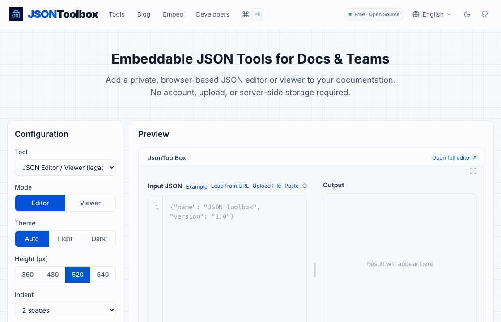

## v1.0.0 — Embed Any Tool, Carry Your JSON Across, and Work Offline

Your JSON tools now work where you do: drop any of the 31 tools into your own docs with one iframe, move the current input to the next tool without copying it, and reopen cached tools without a network connection.



*Demo: 14.8 s, no audio. [MP4 version](https://raw.githubusercontent.com/kbmjj123/jsontoolbox.cc/v1.0.0/public/screenshots/v1.0.0-embed.mp4).*

### What's new

- **Embed any tool.** `/embed/tool?tool=<slug>` renders any of the 31 tools in a clean iframe. The [embed generator](https://jsontoolbox.cc/embed) copies the snippet for you, with `theme` (`auto` / `light` / `dark`), `height`, `branding`, and `lang` (`en` / `zh`) controls. New tools become embeddable automatically because slugs are resolved from the tool registry.
- **Carry your input across tools.** "Related tools" links now append `#in=` with your current text. The `jtb1d` payload is compressed with deflate-raw and kept in the URL fragment, so it never reaches a server log or a Referer header. Open the link and the next tool starts with your data already in place.
- **A first offline layer.** A service worker is registered in production, and a web app manifest makes the site installable by browsers that offer it. Previously visited pages and assets are served from cache when the network is unavailable.
- **`?example=` deep links.** Link straight to a tool pre-filled with a saved example.

### How to use

1. Open the [embed generator](https://jsontoolbox.cc/embed), pick a tool, set the theme, height and language, then copy the iframe.
2. Paste it into your docs, blog or internal wiki. Everything still runs in your visitor's browser — no JSON is uploaded.
3. On a hosted tool page, paste JSON and follow a "Related tools" link to continue in the next tool with the same input.

```html
<iframe
  src="https://jsontoolbox.cc/embed/tool?tool=json-to-csv&theme=dark&height=520&branding=0&lang=en"
  width="100%"
  height="520"
  loading="lazy"
  title="JSON to CSV">
</iframe>
```

Try the tools used above: [JSON to CSV](https://jsontoolbox.cc/tools/convert/json-to-csv) · [Large JSON viewer](https://jsontoolbox.cc/tools/view/large-json-viewer)

### Upgrade and limits

- No breaking changes. The hosted site is already updated — just reload.
- Self-hosters: publishing this Release also triggers the Docker workflow, which pushes an image under the same `v1.0.0` tag.
- Embedded iframes intentionally start empty: they do not read `#in=`. Handoff applies to hosted `/tools/` pages only.
- `#in=` payloads are capped at 512 KB raw / 256 KB decompressed. Oversized or malformed links show a warning and fall back to the first built-in example.
- Offline coverage is best-effort: only previously cached pages and assets work offline; an unvisited tool falls back to the cached homepage, and an offline cold reload is not guaranteed. No custom install prompt is shipped — your browser may still offer installation from its own menu.

### Links

- Embed generator: https://jsontoolbox.cc/embed
- All tools: https://jsontoolbox.cc/tools
- Repository: https://github.com/kbmjj123/jsontoolbox.cc
- Report an issue: https://github.com/kbmjj123/jsontoolbox.cc/issues

### Full changelog

https://github.com/kbmjj123/jsontoolbox.cc/compare/v1.0.0...HEAD
